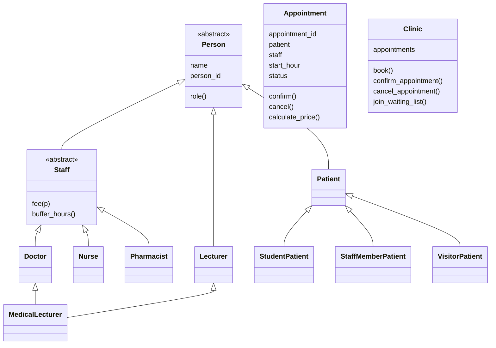

# Clinic Appointment System

A Python-based Clinic Appointment System developed using Object-Oriented Programming (OOP) principles.

## 1. Project Description

The system manages clinic appointments, patients and healthcare staff. It demonstrates encapsulation, inheritance, abstraction, polymorphism, multiple inheritance, exception handling and file logging.

## 2. Features

- Patient and staff registration.
- Appointment booking, confirmation and cancellation.
- Appointment status management using PENDING, CONFIRMED and CANCELLED.
- Prevention of invalid appointment cancellations.
- Staff consultation fee calculations.
- Patient discounts for students, staff members and visitors.
- Staff waiting lists.
- Emergency bookings that can replace pending appointments.
- Staff-specific appointment buffer periods.
- File logging of successful and failed operations.
- Automated unit tests.

## 3. Class Diagram



## 4. Project Structure

```text
clinic-appointment-system/
│
├── README.md
├── .gitignore
│
├── src/
│   ├── main.py
│   ├── person.py
│   ├── appointment.py
│   ├── clinic.py
│   └── clock.py
│
└── tests/
    ├── __init__.py
    └── test_clinic.py
```

## 5. How to Run the Project

Make sure Python is installed.

From the project directory, run:

```bash
python src/main.py
```

To run the automated tests:

```bash
python -m unittest discover -s tests -v
```

## 6. Design Decisions

**D1: Appointment cancellation rule**

The two-hour cancellation rule is implemented in the Appointment class because an appointment controls its own status and cancellation rules. This keeps appointment-related rules together.

**D2: Time management and testing**

A Clock abstraction is used so that the system can receive different clock implementations. A FakeClock allows tests to control time without depending on the computer's actual system time.

**D3: Adding a Pharmacist**

Pharmacist inherits from Staff and implements its own fee calculation. The existing polymorphic fee-processing code does not need to be changed when a new staff subclass is introduced.

**D4: MedicalLecturer multiple inheritance**

MedicalLecturer inherits from Doctor and Lecturer. Python's cooperative multiple inheritance using `super()` and method resolution order allows the Person constructor to run once. The MedicalLecturer uses the Doctor fee calculation.

**D5: Logging failures**

The Clinic uses a context manager to manage the log file. The `__enter__()` and `__exit__()` methods open and close the log. A `try`/`except`/`finally` structure helps handle failures and ensure that the log is closed.

**D6: Additional appointment requirements**

- Waiting list: When an appointment is cancelled, the first eligible waiting patient is offered the available slot.
- Emergency booking: An emergency booking can replace a PENDING appointment at the same hour, but cannot replace a CONFIRMED appointment.
- Buffer periods: Doctors have a two-hour buffer, nurses have a one-hour buffer and pharmacists have no additional buffer.
- Patient discounts: Students pay 50%, staff members pay 0% and visitors pay 100% of the applicable staff fee.

## 7. Testing

The project includes automated unit tests covering appointment rules, staff availability, waiting lists, emergency bookings, discounts, logging and multiple inheritance.

Latest test result:

```text
Ran 19 tests
OK
```

## 8. Technologies Used

- Python
- Object-Oriented Programming
- Python unittest framework
- Git and GitHub